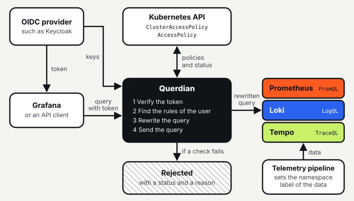
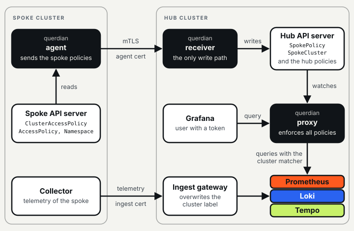

# How Querdian works

Querdian is a reverse proxy between a client, for example Grafana, and Prometheus, Loki and Tempo. It
gives each user only the data that the policies permit. This page shows the parts and the paths.

In short:

* The client sends each query with the OIDC token of the user.
* Querdian adds label matchers to the query, with a real parser for PromQL, LogQL and TraceQL.
* Policies are Kubernetes objects. They only grant access.
* Querdian fails closed: it rejects each request that it cannot check.

## The path of a query



1. **Verify the token.** Querdian verifies the signature, the issuer and the audience of the token with
   the keys of the OIDC provider. The user name and the groups come from the token.
2. **Find the rules of the user.** Querdian watches the policies in the Kubernetes API and compiles
   them. The access of a request is the union of all rules that match the user name or a group of the
   user.
3. **Rewrite the query.** Querdian parses the query and adds the matchers of a rule to each selector.
   If more than one rule matches, the query gets one copy of the selector for each rule. Querdian does
   not use string replacement.
4. **Send the query to the backend.** Querdian also changes some answers: it replaces the values of
   redacted labels (see the [policy guide](policy-guide.md#denied-labels)), and it filters some answers
   of Tempo (see [limitations](limitations.md)).

Example for a user of the group `order-team`, with access to the namespace `order-service`:

```
sum by (route) (rate(http_requests_total{status=~"5.."}[5m]))
sum by (route) (rate(http_requests_total{namespace="order-service",status=~"5.."}[5m]))
```

The first line is the query of the user. The second line is the query that Prometheus gets.

If Querdian cannot check a request, it rejects the request and gives a reason:

| Case | Answer |
|---|---|
| No token, or a token that is not valid | `401` |
| No rule for the user, a path that is not in the endpoint list, a denied label | `403` |
| A query that does not parse, or that Querdian cannot rewrite exactly | `400` |
| Querdian is not ready, for example it has no policies or no keys of the OIDC provider | `503` |

See [troubleshooting](troubleshooting.md) for all reasons, and [limitations](limitations.md) for the
queries that Querdian rejects.

## Policies

| Kind | Scope | Author | Grants |
|---|---|---|---|
| `AccessPolicy` | one namespace | the team of the namespace | data with the namespace label of that namespace; its matchers can only make the access smaller |
| `ClusterAccessPolicy` | the cluster | the platform admin | data that its matchers select, or all data (`unrestricted: true`) |

Querdian writes the result of each policy to its status. A policy that is not valid grants nothing. See
the [policy guide](policy-guide.md).

## The assumption

The isolation depends on the namespace label of the data in the backends. The telemetry pipeline must
set this label. A workload must not be able to set it. Querdian cannot verify this. See the
[threat model](security/threat-model.md).

## Hub and spoke

One Querdian on a central hub cluster can enforce the policies of more than one cluster. The spoke
clusters keep their policies, and the hub stores the telemetry.



The drawing has three paths:

* **Policies (top).** The agent in each spoke reads the policies and the namespaces of the spoke. It
  sends them to the receiver on the hub over mTLS. The receiver is the only component that accepts data
  from the spokes. It stores each spoke policy as a `SpokePolicy` object.
* **Queries (middle).** The proxy watches the hub policies and the `SpokePolicy` objects, and enforces
  all of them. It takes the cluster of a policy from the origin of the policy, not from its text: each
  spoke policy gets a matcher on the cluster label of its spoke.
* **Telemetry (bottom).** Each spoke sends its telemetry to an ingest gateway on the hub with a
  credential of its own. The gateway must overwrite the cluster label from that credential.

The ingest gateway is not a part of Querdian, and Querdian cannot verify the cluster label. A spoke
policy grants only the data of its spoke if the gateway obeys this requirement (see
[cluster label integrity](multicluster.md#cluster-label-integrity-the-ingest-gateway)).

The policies of a spoke grant nothing when the spoke does not sync for 48 hours (the default). See
[multi-cluster](multicluster.md) for the requirements and the steps, and the
[multi-cluster quickstart](quickstart-multicluster.md) for a demo.
