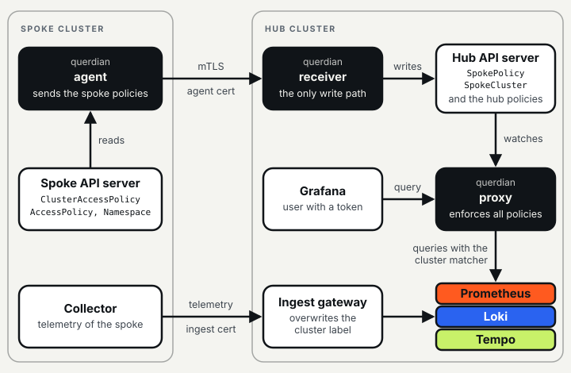

# Multi-cluster enforcement

This guide tells an operator how to use one Querdian on a central **hub** cluster for the policies of
several **spoke** clusters. The hub stores the metrics, logs and traces of all clusters.

In short:

* One Querdian on the hub enforces the policies of all clusters. A spoke runs only `querdian agent`.
* Querdian takes the cluster of a policy from its origin, never from the policy text. For a spoke
  policy, the origin is the agent cert.
* Isolation between the spokes depends on an ingest gateway that overwrites the cluster label. Querdian
  cannot verify this.
* The policies of a spoke stop when the spoke does not sync for `maxStaleness` (default 48 hours). Hub
  policies never expire.
* Do the [migration steps](#migration-ordered-steps) in their order.

> **The feature is new and alpha.** Without the `multicluster` block in the static configuration,
> Querdian works as a single-cluster proxy and nothing on this page applies.

Read the [policy guide](policy-guide.md) and [operations](operations.md) first. The
[multi-cluster reference](multicluster-reference.md) gives the configuration fields, the flags of the
receiver and the agent, and the metrics. Related: [limitations](limitations.md#multi-cluster),
[threat model](security/threat-model.md#12-multi-cluster),
[troubleshooting](troubleshooting.md#receiver-http-statuses). To see the feature on a laptop, run the
[multi-cluster quickstart](quickstart-multicluster.md): one hub and two spokes on kind, with the ordered
steps of this guide.

Contents: [how it works](#how-it-works) / [requirements](#requirements) /
[migration](#migration-ordered-steps) / [tenant setups](#tenant-setups) /
[day-2 operations](#day-2-operations)

## How it works



[How Querdian works](architecture.md#hub-and-spoke) explains the three paths of the diagram. The agent
sends a digest of the policies, or the full state when the digest differs. The receiver also writes the
status of the `SpokeCluster` object.

Three processes from the same image take part:

| Process | Runs in | Task |
|---|---|---|
| `querdian` (the proxy), with the `multicluster` block | the hub | Compiles the hub policies and the `SpokePolicy` objects into one snapshot and enforces them. It also keeps a table of spoke deadlines, outside the snapshot, and checks it on each request. |
| `querdian receiver` | the hub, as a separate Deployment | The only component with a write path. It accepts syncs from agents over mTLS, stores each spoke policy as a cluster-scoped `SpokePolicy` object and writes `SpokeCluster.status.lastSyncTime`. |
| `querdian agent` | each spoke | Reads the policies and namespaces of its spoke from the spoke API server and sends them to the receiver. It needs only an outbound path to the receiver. |

Querdian takes the cluster of a policy from its **origin**, never from the policy text. This is the
same as for the namespace of an `AccessPolicy`. The policies compile to these scopes:

| Policy source | Author | Compiled scope |
|---|---|---|
| Hub `ClusterAccessPolicy` | hub platform admin | its own matchers; it must state its cluster scope (see [step 1](#1-review-each-hub-clusteraccesspolicy)) |
| Hub `AccessPolicy` | hub team | `<namespaceLabel>="X"`, `<clusterLabel>="<hubCluster>"`, plus its matchers |
| Spoke `ClusterAccessPolicy` | spoke admin | `<clusterLabel>="<spoke>"`, plus its matchers |
| Spoke `AccessPolicy` | spoke team | `<namespaceLabel>="X"`, `<clusterLabel>="<spoke>"`, plus its matchers |

* A spoke rule with `unrestricted: true` compiles to the single matcher `<clusterLabel>="<spoke>"`. A
  spoke rule never becomes unrestricted, so Querdian always rewrites the queries of a spoke admin.
* A spoke matcher on the cluster label stays ANDed with the implicit matcher. It can only narrow.
* A spoke admin can grant the data of that spoke to any user or group. All clusters use the same
  OIDC issuer, so group names mean the same thing everywhere.

**Time limit.** Hub policies never expire. The policies of a spoke stop when the spoke has not synced
for `maxStaleness` (default 48 hours). The next valid sync restores them with no manual work. By
default, the agent sends a heartbeat each minute, so a revoked spoke policy normally stops within one
heartbeat. See [time limit and outages](#time-limit-and-outages).

## Requirements

### Cluster label integrity: the ingest gateway

The cluster label is to the spokes what the namespace label is to the teams
([threat model, section 1](security/threat-model.md#1-namespace-label-integrity-the-assumption-everything-rests-on)).
Querdian cannot verify any of the requirements below. A startup check cannot help either: Querdian
does not query backends at startup, and an empty result does not prove a wrong configuration.

* Each spoke sends telemetry with its own credential (normally an mTLS client cert). The ingest
  gateway on the hub sets the cluster label **from that credential**.
* The gateway must **overwrite** the label, not add it, for all three signals: metrics (remote write),
  logs (Loki push) and traces (OTLP). A spoke that sends `cluster="cluster-b"` in its own data must be
  stored as `cluster="cluster-a"`.
* An "add if missing" rule is not sufficient. Examples are an OpenTelemetry `resource` processor with
  `action: insert`, or a relabel rule that keeps the value that is already in the data. Use `upsert`, or replace the label
  unconditionally.
* Writers on the hub that bypass the gateway must not be able to set the label of a spoke. This
  includes ruler output (Prometheus, Mimir and Loki recording rules) and hub agents.
* The `SpokeCluster` name must be equal to the label value that the gateway writes.
* Cluster names must not change: a renamed cluster loses its policies, and its old data keeps the old
  label.

To test the overwrite, send one sample, one log line and one span from a spoke with a forged cluster
label. Then query the backend directly. The stored value must be the cluster of the credential.

### Hub telemetry

Hub telemetry must carry `<clusterLabel>="<hubCluster>"`. This includes ruler output and the data of hub
agents. Each hub `AccessPolicy` gets the implicit matcher `<clusterLabel>="<hubCluster>"`. Thus hub data
without the label is invisible to hub teams, and they get no error. Step 2 of the migration gives a
verification query for each signal.

### The agent certificate and its CA

The receiver terminates mTLS itself and takes the cluster from the client cert only. The sync
protocol has no cluster field.

* **A hub-controlled CA.** `querdian receiver --client-ca-file` must contain only a CA that the hub
  controls. No spoke may be able to issue certs from it: a spoke admin with access to the CA key can
  issue a cert for a different spoke. Do not use a cert-manager issuer whose CA key is stored in a
  spoke. Issue the cert on the hub and copy it to the spoke. As an alternative, use a process that
  signs the certs with the approval of the hub.
* **A dedicated agent cert.** The agent cert must not be the ingest cert, and its identity must not
  occur on an ingest cert. If it does, the theft of a write-only telemetry credential also gives the
  power to grant read access. Use a separate CA for agent certs, so that the receiver does not accept
  ingest certs at all. The `SpokeCluster` object, which only a hub admin can write, is the link between
  the agent identity and the cluster name.
* **Exactly one URI SAN.** The identity is the URI SAN of the client cert. The receiver rejects a cert
  with no URI SAN or with several URI SANs. It ignores other SANs (DNS names) and the subject.
* **The last path segment is the cluster name.** The URI SAN must be equal to `spec.identity` of the
  `SpokeCluster`. The last path segment of `spec.identity` must be equal to the `SpokeCluster` name. A
  suffix does not count: `spiffe://mla.example.com/agent/x-cluster-a` does not match `cluster-a`. If
  the segment differs, the policies of that spoke grant nothing (`SpokeClusterInvalid`), and the
  receiver rejects its syncs.
* **Canonical form.** The identity must be an absolute URI with a scheme, a host and a path, in the
  form that Go's `url.URL.String()` gives back (for example a lower-case scheme). It must not contain
  `%`, `?`, `#`, `@` or `\`. A non-canonical identity never matches.

A recommended format is `spiffe://<trust-domain>/agent/<generation>/<cluster>`, for example
`spiffe://mla.example.com/agent/1/cluster-a`. With the middle segment, you can issue a cert with a new
identity for the same cluster after a theft (see [stolen agent cert](#stolen-agent-cert)).

The receiver accepts TLS 1.2 or later. The agent connects with TLS 1.3 only. The agent verifies the
receiver cert with `--tls-ca-file`. A load balancer between the agent and the receiver must pass TLS
through: if it terminates TLS, the client cert does not get to the receiver.

### A spoke runs only the agent

Do not run a standalone Querdian on a spoke, not even for local queries. In a multi-cluster deployment,
the hub Querdian is the only enforcement point for the policies of a spoke, and the spoke runs only
`querdian agent`.

A local Querdian on the spoke would write the `Ready` condition and `status.observedGeneration` of the
same policy objects from its own compile. The status would then change again and again, and it would not
show what the hub enforces. The Helm chart refuses to render the agent together with the proxy in one
release. It cannot see a second release, or a proxy that you install by other means. See also
[day-2 operations](#do-not-add-a-standalone-querdian-to-a-spoke).

## Migration: ordered steps

Do these steps in this order. A later step does not repair a mistake in an earlier step.

### 0. Upgrade Querdian and the CRDs, without the multicluster block

1. Upgrade Querdian to a version with multi-cluster support.
2. Apply its CRDs. Do not set the `multicluster` block yet.
3. Make sure that the new CRDs are installed:

   ```sh
   kubectl get crd spokeclusters.policy.querdian.dev spokepolicies.policy.querdian.dev
   kubectl explain clusteraccesspolicy.spec.rules.allClusters
   ```

The new CRDs add the `allClusters` field to `ClusterAccessPolicy`, and the kinds `SpokeCluster` and
`SpokePolicy`. With an older CRD, the API server prunes `allClusters` or `kubectl` rejects it. Step 1
would then have no effect, and the rules would become `InvalidClusterScope` in step 3. Without the
block, the new version behaves as before.

### 1. Review each hub ClusterAccessPolicy

Under the `multicluster` block, each rule of a hub `ClusterAccessPolicy` must state its cluster scope.
A new spoke must not silently widen a grant. For **each backend** of the rule, one of these must be
true. If not, the policy is `InvalidClusterScope` and grants nothing.

| Cluster scope | Condition |
|---|---|
| A fixed set of clusters | The rule has a matcher on the `clusterLabel` of that backend that names a **fixed set of non-empty cluster names**: an `Equal`, or a `RegexMatch` such as `mla\|cluster-a` or `cluster-(a\|b)`. |
| All clusters | The rule sets `allClusters: true` and has no matcher on the `clusterLabel` of that backend. |
| Unrestricted | The rule sets `unrestricted: true`. An unrestricted rule covers all clusters, also spokes that you add later. |

These are not accepted as a fixed set:

* `NotEqual` and `RegexNoMatch`;
* an open regex such as `.+` or `cluster-.*` (each also matches each new spoke);
* an empty value (it matches data without a cluster label);
* case-insensitive regexes, and regexes with more than 1024 names.

`allClusters` and `unrestricted` must not be set together.

```yaml
apiVersion: policy.querdian.dev/v1alpha1
kind: ClusterAccessPolicy
metadata:
  name: sre-shared-infra
spec:
  subjects:
    groups: [sre]
  rules:
    - backends: [metrics]
      matchers:
        - {name: cluster, op: RegexMatch, value: "mla|cluster-a"}   # a fixed set of clusters
        - {name: namespace, op: RegexMatch, value: "kube-system|ingress-nginx"}
    - backends: [logs]
      tenants: [tenant1]
      allClusters: true                                              # all clusters, also new ones
      matchers:
        - {name: k8s_namespace_name, op: Equal, value: kube-system}
```

Each matcher of a rule applies to each backend of the rule. If the backends of a rule have different
cluster labels (`cluster` and `k8s_cluster_name` above), write one rule for each backend, as in the
example. A rule with both backends and both cluster matchers compiles, but no data has both labels.
Thus it grants nothing.

Without the `multicluster` block, `allClusters` has no effect and the policy stays valid. Thus, after
step 0, you can add `allClusters: true` or cluster matchers to the hub policies before you set the
block.

1. Find the policies to change:

   ```sh
   kubectl get cap -o name
   ```

2. For each rule, decide if a new spoke must be included (`allClusters`) or not (a fixed set). A cluster
   matcher that is correct today can become too narrow later: `mla|cluster-a` does not grant
   `cluster-b`.
3. Change the rules.

### 2. Make sure that hub telemetry carries the hub cluster label

1. Configure the collection pipeline of the hub and the ruler, so that all hub data carries
   `<clusterLabel>="<hubCluster>"`.
2. Check each signal directly against the backend, or through Querdian as an unrestricted user. On a
   multi-tenant backend, check each tenant. Use the queries below.

The examples use `hubCluster: mla`, `clusterLabel: cluster` on Prometheus and Loki, and
`clusterLabel: resource.k8s.cluster.name` on Tempo. Before the first spoke sends data, each query must
return no data (Prometheus, Loki) or two equal values (Tempo).

* **Metrics** (PromQL). `!=` also matches series without the label. This includes recording-rule
  output. Use a range: an instant query finds only series with a sample in the lookback window
  (5 minutes by default), and it can miss recording rules with a long interval.

  ```promql
  count by (__name__) (last_over_time({__name__=~".+", cluster!="mla"}[1h]))
  ```

* **Logs** (LogQL). A stream selector needs a matcher that does not match the empty string. Use a
  label that each stream has, such as the namespace label or `service_name`:

  ```logql
  sum by (k8s_namespace_name) (count_over_time({k8s_namespace_name=~".+", cluster!="mla"}[1h]))
  ```

  Do the query again with each label that your log pipeline always sets. Then streams without the
  namespace label are also checked.

* **Traces** (TraceQL metrics). A span without the attribute matches neither `=` nor `!=`. Thus
  compare two counts over the same time range (`start` and `end`). They must be equal. TraceQL metrics
  queries need the Tempo metrics generator or the local-blocks processor; enable one of them for this
  check. Send the queries directly to Tempo:

  ```traceql
  {} | count_over_time()
  { resource.k8s.cluster.name = "mla" } | count_over_time()
  ```

Old hub data, from before this step, has no cluster label. Hub `AccessPolicy` users lose access to it
until it leaves retention (see [limitations](limitations.md#multi-cluster)).

### 3. Set the multicluster block and clusterLabel

> **Warning:** Without the additional RBAC, the new pods never become ready and the rollout stops.

1. Add the `multicluster` block and a `clusterLabel` on each backend to the hub configuration (see
   [hub configuration](multicluster-reference.md#hub-static-configuration)).
2. Give the proxy the additional RBAC for the new kinds (see
   [hub configuration](multicluster-reference.md#hub-static-configuration)). The Helm chart adds it with
   `config.multicluster`.
3. Restart the proxy.
4. Make sure that no hub policy has become invalid. Look for `InvalidClusterScope`:

   ```sh
   kubectl get cap,ap -A    # look for InvalidClusterScope
   ```

From now on, each hub `AccessPolicy` also carries `<clusterLabel>="<hubCluster>"`.

### 4. Install the receiver and register the spokes

1. Deploy `querdian receiver` on the hub (see [receiver](multicluster-reference.md#querdian-receiver)).
2. Make the receiver reachable from the spokes.
3. For each spoke, issue an agent cert (see [the agent certificate](#the-agent-certificate-and-its-ca)).
4. For each spoke, create a `SpokeCluster` object with `suspended: true`. The spoke then grants nothing
   until step 6. The receiver rejects the syncs of a suspended spoke, so `LastSync` stays empty for now.
5. Install `querdian agent` in each spoke (see [agent](multicluster-reference.md#querdian-agent)).

### 5. Connect each spoke to the ingest gateway and test the overwrite

> **Warning:** Connect a spoke to the ingest gateway only after step 3. If spoke data arrives before the
> block is set, each hub `AccessPolicy` for namespace `X` also matches namespace `X` of that spoke. No
> check can find this condition.

1. Before a spoke connects, configure the gateway to **overwrite** the cluster label for all three
   signals (see [the ingest gateway](#cluster-label-integrity-the-ingest-gateway)).
2. Connect the spoke to the gateway.
3. Do the forged-label test while the spoke is still suspended. Send one sample, one log line and one
   span with the cluster label of a different spoke, and with the hub name.
4. Query the backend directly. The stored value must be the cluster of the credential.

Do the test for each new spoke. Isolation between spokes depends on this overwrite, and Querdian cannot
check it.

### 6. Unsuspend each tested spoke

> **Warning:** Unsuspend a spoke only after its forged-label test passes.

1. Set `suspended: false` on the `SpokeCluster` of the spoke. The agent then syncs, and the grants of
   the spoke become active.
2. Make sure that the spoke syncs:

   ```sh
   kubectl get spokeclusters       # LastSync must be recent
   kubectl get spokepolicies       # one object for each policy of each spoke
   ```

For each spoke that joins later, do steps 4 to 6 again.

## Tenant setups

The design does not assume a tenant setup. For a backend with a `tenantHeader`:

* The `tenants` of a spoke `ClusterAccessPolicy` rule must be a subset of `SpokeCluster.spec.tenants`.
* The tenant of a spoke `AccessPolicy` is the namespace label in the spoke, then `defaultTenant`. It
  must be in `spec.tenants`. The comparison is exact: Querdian trims a hub namespace label, but not a
  spoke label.
* Any other tenant makes the policy invalid with `TenantNotAllowed`. Thus a spoke admin cannot select a
  tenant that the hub did not allow. A spoke `AccessPolicy` with no tenant label and no
  `defaultTenant` is `TenantNotAssigned`.
* A change to `spec.tenants` or `defaultTenant` starts a recompile, so a smaller allow-list removes
  the grant at once.
* Hub policies have no allow-list.

| Setup | Result |
|---|---|
| No tenant header | Terms have no tenant. Terms of several clusters merge where the [DNF rules](policy-guide.md#union-semantics-in-plain-language) permit it. |
| One tenant for all clusters | The same as above, with one tenant header. Set `tenants: [shared]` on each `SpokeCluster`. |
| One tenant for each cluster | A user with grants in two clusters has a cross-tenant union, and the cluster matcher makes the terms differ. This needs `tenantFederation: tenantIdLabel` (Loki, Mimir). If not, the request is `403 cross_tenant_union_unsupported`: today on Tempo, and on Prometheus/Thanos with a tenant header. |
| Several tenants for each cluster | The rules of the row above apply when the terms of the user span tenants. |

The setups with a cross-tenant union also get the current limits of federated tenants:

* On Loki, tenant-bound metadata endpoints (`labels`, `label/<name>/values`, `series`, `index/*`) give
  empty or wrong results, and `tail` does not work with several tenants.
* On Tempo, tenant-bound terms give `400 unsupported`.

See [limitations](limitations.md#logql) and [TraceQL and Tempo](limitations.md#traceql-and-tempo). If
most users read one cluster at a time, use one tenant for all clusters, or no tenant header. These
setups do not have the limits.

## Day-2 operations

The [multi-cluster reference](multicluster-reference.md#metrics-and-alerts) gives the metrics and the
alerts that find a spoke before it expires.

### Certificate rotation

* **Agent.** The agent reads its cert, key and CA file again before each request. Thus a rotated cert
  (for example a cert-manager renewal into a mounted Secret) takes effect at the next heartbeat, with no
  restart. If the agent cannot read a file during the rotation, it keeps the last good values. A normal
  renewal keeps the same URI SAN, so the hub needs no change.
* **Receiver.** The receiver reads `--tls-cert-file`, `--tls-key-file` and `--client-ca-file` one time,
  at startup. **Restart the receiver after a rotation** of its server cert or of the client CA bundle.

To change the client CA:

1. Put the old and the new CA in the bundle.
2. Restart the receiver.
3. Rotate the agent certs.
4. Remove the old CA from the bundle.
5. Restart the receiver again.

### Time limit and outages

| Event | Effect |
|---|---|
| A spoke policy is revoked | The revocation takes up to one heartbeat. During an outage of the agent, it takes up to the time limit. The limit on changed syncs (one in 10 seconds) can delay a revocation by one retry. |
| The agent cert expires | Only the syncs stop. The grants continue until the time limit. |
| The receiver, the network path or the hub API server fails | **All** spokes expire after the time limit. Hub grants stay active. A hub admin can add a temporary hub `ClusterAccessPolicy`. |
| One spoke policy is over a [size limit](policy-guide.md#size-limits) | The receiver rejects the whole sync of its spoke (see below). |
| A spoke expires or is suspended, or its `SpokeCluster` gets a new spec or is created again | An open Loki tail that uses terms of that spoke closes within 10 seconds (WebSocket close code 1008, reason `policy source expired`). An example is a smaller tenant allow-list. A heartbeat does not close the tail. |

A spoke expires if one of these conditions is true:

* No `SpokeCluster` exists.
* `suspended` is true.
* The `SpokeCluster` is in deletion.
* `lastSyncTime` is absent, or more than five minutes in the future.
* `status.observedGeneration` differs from `metadata.generation`.
* The current snapshot was not yet compiled from the current version of the `SpokeCluster` (its UID and
  generation). Thus a deleted and re-created object also counts as new.
* `maxStaleness` has passed since `lastSyncTime`.

An expired rule gives no terms, but its `labels.deny` and `labels.redact` stay active. Thus expiry only
narrows access. A user whose grants all come from expired spokes gets `403 policy_source_expired`. The
message does not name the cluster.

**A policy over a size limit.** The receiver rejects the whole sync of the spoke with `400` and the
message `invalid policy: ...`, which names the field. The spoke keeps its last accepted state, and all
its grants expire after the time limit. These signs show the problem:

* the agent log line `agent: the receiver rejected the sync` with `status=400`;
* `querdian_agent_syncs_total{result="error"}`;
* a `querdian_agent_last_sync_timestamp_seconds` that does not increase.

To correct the problem, make the policy in the spoke smaller, or split it.

### Suspend a spoke

```sh
kubectl patch spokecluster cluster-a --type merge -p '{"spec":{"suspended":true}}'
```

New requests stop when each replica sees the change, normally in about one second. Open tails close
within 10 seconds. The receiver rejects each sync of a suspended spoke with `403`. After
`suspended: false`, the grants return only after a new valid sync, because the generation changed.

### Stolen agent cert

The time limit gives no protection against a stolen agent cert, because the holder can renew
`lastSyncTime`. The holder can write any grant for that spoke, but not for a different spoke. There is
no certificate revocation list. Do these steps on the hub:

1. Suspend the spoke (see above). The receiver rejects each sync, new requests stop in about one
   second, and open tails close within 10 seconds. The spoke stays suspended until step 5.
2. Find out how the cert was stolen. If the spoke itself leaked it, fix the cause first, because a new
   cert on that spoke would be exposed in the same way. If the CA key itself is exposed, replace the CA
   (see [certificate rotation](#certificate-rotation)) and issue new certs for all spokes.
3. Replace the agent cert:
   * Issue a new agent cert with a **new URI SAN**. The last segment stays the cluster name, for
     example `spiffe://mla.example.com/agent/2/cluster-a`.
   * Change `spec.identity` to the new URI SAN. The old cert then no longer matches.
   * Install the new cert in the spoke.
4. Delete the `SpokePolicy` objects of the spoke. This also removes the `labels.deny` and
   `labels.redact` of forged rules, which stay active while the spoke is suspended:

   ```sh
   kubectl get spokepolicies -o json \
     | jq -r '.items[] | select(.spec.cluster == "cluster-a") | .metadata.name' \
     | xargs -r kubectl delete spokepolicy
   ```

5. Set `suspended: false`. The generation changed, so grants return only after a new valid sync from
   the agent with the new cert.

### Remove a spoke

1. Uninstall the agent in the spoke.
2. On the hub, delete the `SpokeCluster`. The spoke expires at once, and the receiver rejects its
   identity. Kubernetes deletes the `SpokePolicy` objects of the spoke through the owner reference.
3. Revoke the ingest credential of the spoke at the ingest gateway, so that no new data arrives with
   its cluster name.
4. Remove the cluster name from hub `ClusterAccessPolicy` matchers where it is no longer necessary.

The data of the spoke stays in the backends until it leaves retention. Hub rules with `allClusters`,
with `unrestricted` or with a matcher that names the cluster still match it. **Do not reuse the
cluster name** for a different cluster while that data exists: the admin of the new cluster would
control access to the old data.

### Rollback

A rollback to a single-cluster configuration is a risk while spoke data is in the backends.

* Querdian refuses to start if a backend keeps `clusterLabel` without the `multicluster` block.
* If you remove both, each hub `AccessPolicy` loses its cluster matcher and matches namespace `X` of
  **every** spoke. Each `SpokePolicy` grants nothing (`MulticlusterDisabled`), and `allClusters` has no
  effect.

Before such a rollback, do one of these:

* Delete or narrow the hub `AccessPolicy` objects. For example, move them to hub `ClusterAccessPolicy`
  objects with an explicit cluster matcher.
* Keep the block until the spoke data has left retention.

To pause the spokes, suspend them. Do not remove the block.

### Do not add a standalone Querdian to a spoke

This is a [requirement](#a-spoke-runs-only-the-agent), also after the migration. The agent writes the
`Ready` condition and `status.observedGeneration` of the spoke policies. A Querdian proxy that runs in
the same spoke writes the same fields from its own compile. The two writers would change the status
again and again, and the status would not show what the hub enforces.

To change a spoke back into a standalone cluster:

1. Remove the agent and the spoke (see [remove a spoke](#remove-a-spoke)).
2. Install Querdian in that cluster.
